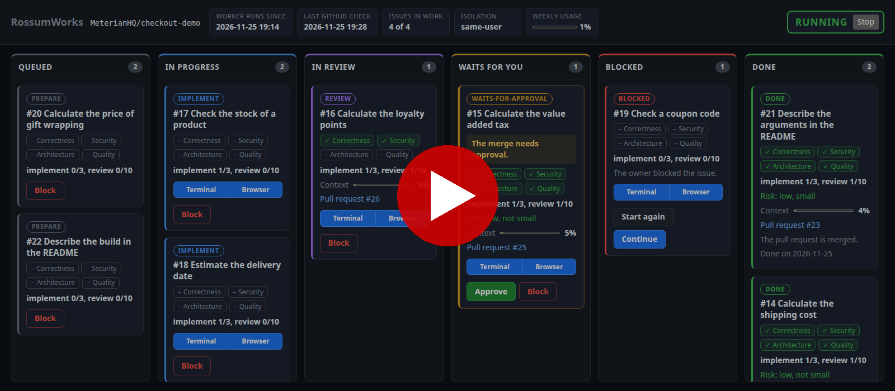

# RossumWorks

[Watch the demo video](https://www.youtube.com/watch?v=fjbBpt8t38E) (5 minutes)

RossumWorks is an AI factory that runs on GitHub. The factory takes an issue, writes the change, builds it, reviews it, opens a pull request, and merges it if safe. It asks for your help when needed.

The factory does its work with `claude` sessions. The **provider** gives these sessions their access to Claude,
and pays for them. There are two providers: your Claude subscription, or an Anthropic API key.

> **Legal warning.** The Anthropic documents do not agree about the use of a subscription from a script.
> Read [Legal considerations](docs/legal-considerations.md) before you select a provider.

## How the factory works

### Architecture

The factory is a three-tier web application:

| Tier | Part of the factory | What it does |
|---|---|---|
| The view | **The board**, a web page | The board shows each issue as a card, so you can see the progress of all the issues on one page. With the buttons on a card, you tell the worker what to do with that issue, for example approve the merge or stop the work.|
| The logic | **The worker**, a Java program on your machine | The worker finds the issues that you give to the factory, and takes each issue through all the steps, from the first change to the merge. In each step, it starts Claude to write or review the code, or it runs your build to test the change. |
| The database | GitHub | GitHub stores everything the factory knows about each issue. The worker writes the progress of the issue in a comment on the issue, the **status comment**. The labels and the assignee of the issue tell who works on it and what to do next. The branch and the pull request hold the change. |

The worker has no database of its own. The database is GitHub. After a restart, the worker reads the state of
each issue from GitHub again. On your machine, it keeps only the files of the work, for example the worktrees.

More than one person can run a factory on the same repository at the same time. Each person uses a GitHub token
of their own account. The assignee of an issue decides which factory works on it. See
[More than one factory](docs/multiple-factories.md).

### The Claude sessions

The worker starts three types of `claude` session for an issue:

- **The agent** writes the change. The worker starts one agent for each issue, and uses it again for each fix.
- **A review** checks the change of the agent. Each review is a new session: it does not share the context
  of the agent.
- **The risk check** gives the risk of the change: low, medium, or high. It also tells if the change is small.

### The workflow of an issue

The folder `.factory` of your repository holds the definition of **the workflow**. It defines the states and the
transitions, the prompts of the sessions, the build command, and the target branch of the merges. The default workflow follows this flow:

1. You add the label `factory` to an issue.
2. At its next poll, the worker assigns the issue to the GitHub account of its token. It writes the status
   comment on the issue.
3. The worker makes a separate worktree for the issue. The agent writes the change in this worktree.
4. The worker builds the change with the build command of your repository, for example `./mvnw verify`. This
   command must compile the program and run its tests, because it is the first check of each change. When the
   build fails, the agent gets the errors and fixes the change. When the build passes, the worker pushes the
   branch and opens a pull request.
5. The reviews check the change. When a review rejects the change, the agent fixes it. Then the worker
   builds the change again.
6. When all the reviews approve the change, the risk check gives the risk of the change.
7. When the risk is low and the change is small, the worker merges the pull request. Else, it waits for your
   approval: the label `factory:approve`, or the button Approve on the board.

You follow each issue on the board or on GitHub. You can block an issue. You can also talk to the agent of an
issue in a live conversation: this is the **live mode**.

You can change the workflow. See [Factory definition](docs/factory-definition.md).

## Requirements

- A Linux machine. The factory does not work on macOS or on Windows. It can probably work in WSL 2 on Windows, but nobody tested it.
- For the jar only: a JDK 21 or later. The native programs for Linux x64 and Linux arm64 need no JDK, but they
  need glibc 2.34 or later, for example Ubuntu 22.04, Debian 12, or RHEL 9.
- `claude`, `git`, `setsid`, `kill`, `tmux`, `jq`, and `curl` on the `PATH`.
- A provider: a `claude` login with your Claude subscription, or an Anthropic API key. See
  [Providers](docs/providers.md).
- A `gh` login, or a GitHub token in `FACTORY_GITHUB_TOKEN`.

## Tutorial

The [tutorial](docs/tutorial.md) lets you try the factory on a small sample project. You give one issue to the
factory, and you watch it from the label to the merge. Optional lessons show more functions.

## Quick start

This procedure installs the factory on one of your GitHub repositories, and starts the worker. Do the
procedure on the machine that runs the worker, after you get the items in "Requirements".

1. Prepare the provider of the `claude` sessions: by default your subscription is used. See [Providers](docs/providers.md).
2. Log in to GitHub with `gh auth login`.
3. Download the native program of your machine from the
   [GitHub releases](https://github.com/MeterianHQ/rossumworks/releases), for example
   `rossumworks-$VERSION-linux-x64`, and make it executable. On another machine, download `rossumworks-$VERSION.jar`.
4. Go to the folder that hosts a clone of your repository.
5. Run `<path of the native program> create`, and answer the questions. With the jar, run
   `java -jar <path of the jar> create`.
6. `create` opens a pull request called `factory/setup` on your repository. Merge it.
7. Pull the default branch in your clone, to get `.factory/run.sh`.
8. Run `.factory/run.sh`. This script starts the worker with the latest release of the factory.

The factory is now ready to work. When the worker starts, it writes the address of the board, for example
`The web page is at http://127.0.0.1:8090/`. Open this address in your browser. If you gave a password to
`create`, the board asks for it once on each device.

The board shows the columns of the workflow: Queued, In progress, In review, Waits for you, Blocked, and
Done. Each issue of the factory is a card that moves from column to column. The column
"Waits for you" holds the issues that need you, for example to approve a merge. The buttons on a card let you
approve the merge, block the issue, or talk to its agent. Only the subscription has the live mode, so with an
API key you cannot talk to the agent.

To give the factory an issue, add the label `factory` to the issue on GitHub. At its next poll, the worker
takes the issue, and its card shows in Queued. When the work is done, the issue has a pull request with the
change. You can give the factory as many issues as you want. By default, the worker works on two issues at
the same time, and the others wait in Queued. See [Configuration](docs/configuration.md).

[Getting started](docs/getting-started.md) gives the full procedure and the parameters of `create`.
[Web page](docs/web-page.md) tells all about the board and its buttons.
[Issues and labels](docs/issues-and-labels.md) tells how you control an issue with the labels.

## Documents

| Page | Read it when you want to |
|---|---|
| [Tutorial](docs/tutorial.md) | try the factory on a sample project |
| [Getting started](docs/getting-started.md) | install the factory on a repository, and start the worker |
| [Configuration](docs/configuration.md) | change `worker.yaml`: the limits, the build environment, and the retries |
| [Providers](docs/providers.md) | select the subscription or an API key, and set the daily budget |
| [Issues and labels](docs/issues-and-labels.md) | give work to the factory, and control an issue with the labels |
| [Live mode](docs/live-mode.md) | talk to the agent of an issue |
| [Web page](docs/web-page.md) | use the board, its buttons, and Stop and Start |
| [More than one factory](docs/multiple-factories.md) | run more than one factory on one repository |
| [Events](docs/events.md) | watch the worker from a script or a monitoring agent |
| [Factory definition](docs/factory-definition.md) | change the workflow, the prompts, the build, or the target branch of the merges |
| [Legal considerations](docs/legal-considerations.md) | know the terms of Anthropic about the providers |
| [FAQ](docs/faq.md) | find the answer to a frequent question |
| [Glossary](docs/glossary.md) | find the meaning of a term in these documents |

## Contributing

To build the factory, run its tests, or change its code or its documents, read
[Contributing](CONTRIBUTING.md).

## Where does the name "RossumWorks" come from?

The name comes from *R.U.R.* ("Rossum's Universal Robots"), the play by Karel Čapek from 1920. This play gave
the world the word "robot". Its robots come from a factory, like the work of this project.
