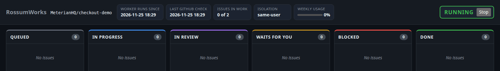
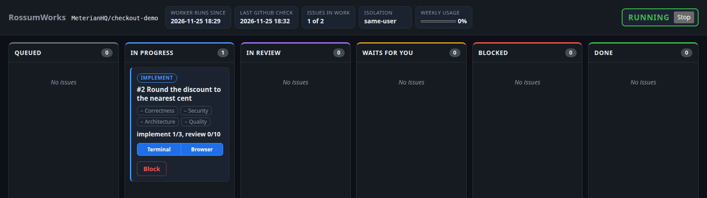
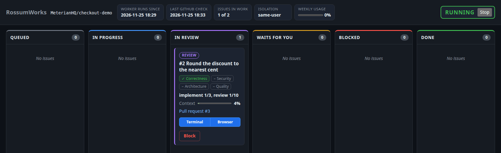
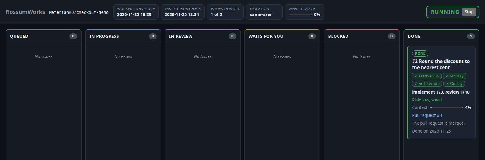
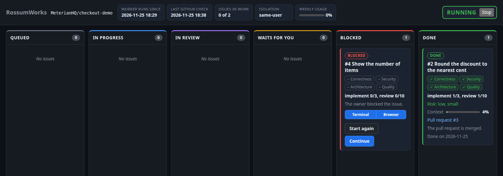
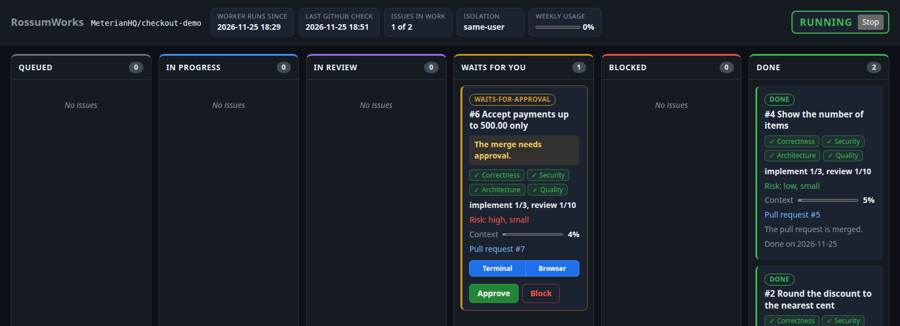
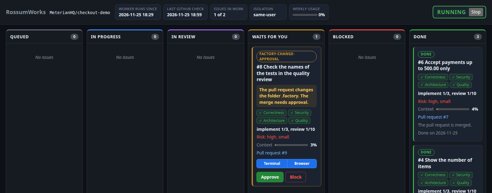
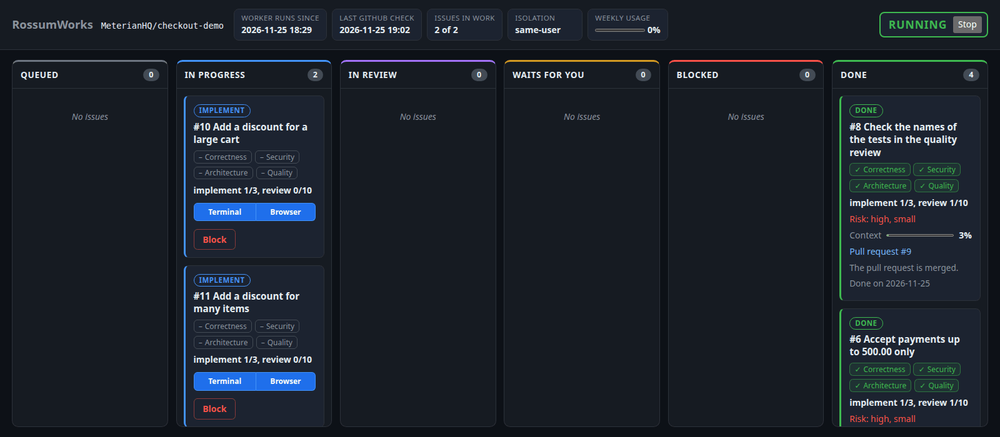

# Tutorial
In this tutorial, you give a small project to RossumWorks. The factory fixes a bug, reviews the fix, and merges it.
[Getting started](getting-started.md) tells how you use the factory on your own project. The
[Glossary](glossary.md) gives the meaning of the terms. The
[demo video](https://www.youtube.com/watch?v=fjbBpt8t38E) shows the factory on a sample project.


## Before you start

**Warning: the agents run commands on your machine, with the rights of your user.**

**Warning: each issue uses your subscription, or costs money with an API key.** A session is a
conversation with `claude`. An agent is a session that writes the change of an issue. A review is a session that checks
the change. The risk check is a session that gives the risk of the change. An issue needs an agent, four reviews, and a
risk check. A review that rejects the change causes more sessions.

**Warning: the Anthropic documents do not agree about the use of a subscription from a script.** Read
[Legal considerations](legal-considerations.md) before you select a provider.

You need:

- Linux or macOS. On macOS, the script `tutorial/create-issues.sh` needs bash 4 or later. macOS includes bash 3.2, so
  install a newer bash, for example with `brew install bash`.
- A JDK 21 or later.
- The `claude` CLI.
- A provider. The provider gives the `claude` sessions their access to Claude, and pays for them. See
  [Providers](providers.md). The default is your Claude subscription, with a `claude` login.
- The `gh` CLI. Run `gh auth login` to log in.
- `git`, `kill`, `tmux`, `jq`, and `curl` on the `PATH`. Linux also needs `setsid`. macOS also needs `perl`, and
  macOS includes it.

For the subscription, do not set `ANTHROPIC_API_KEY`. For an API key, set `ANTHROPIC_API_KEY` to the key.

## Make your repository

1. Open the [template repository](https://github.com/MeterianHQ/rossumworks-tutorial).
2. Select "Use this template". Then select "Create a new repository".
3. Select the owner. Type a name. Select "Private". GitHub can select an organization as the owner. Your account
   must be able to write to the repository and to delete it.
4. Select "Create repository".
5. Clone your repository. Go to the folder of the clone. Replace `<owner>` and `<name>`:

```
gh repo clone <owner>/<name>
cd <name>
```

6. Run the build. It compiles the program and runs its tests. It must pass, because the factory uses the same command
   to check each change:

```
./mvnw verify
```

7. Run the program:

```
m=com.meterian.checkout.CheckoutCommand
java -cp target/classes $m book:19.95:1 --discount=10
```

The program shows `Total: 17.96`. The correct total is 17.95. This is the bug.

## Set up the factory

The factory reads its workflow from the folder `.factory` of your repository. The command `create` makes this folder
in a pull request (PR).

The command `create` asks for the build command. The worker runs the build command after each change of the agent. When
the build fails, the agent gets the errors and fixes the change. When the build passes, the worker opens a PR, and the
reviews start. The sample uses `./mvnw verify`, which is the default answer.

**Warning: an empty password gives a board without a login.** Each program on your machine can then use the board. The
board is the web page of the factory.

1. Download the native program of your machine from the
   [releases](https://github.com/MeterianHQ/rossumworks/releases), for example
   `rossumworks-<version>-linux-x64`, and make it executable. On another machine, download
   `rossumworks-<version>.jar`.
2. Run `<path of the native program> create` in the clone. With the jar, run `java -jar <path of the jar> create`.
3. Push Enter at each question to take the default answer. For an API key, do steps 4 and 5 also.
4. For an API key, type `anthropic-api-key` at the question about the provider.
5. For an API key, type an amount at the question about the daily budget. The daily budget is the maximum cost of
   one day.
6. Read the summary. Type `y` to confirm. Enter is not an answer here.
7. Open the PR `factory/setup` on GitHub. Merge it.
8. Run `git pull` in the clone.
9. Run `.factory/run.sh`. The worker is the program that does the work of the factory. Do not close this terminal.
10. Open <http://127.0.0.1:8090/>. This page is the board. It shows one card for each issue of the factory.

The board is empty at the start:



## Give an issue to the factory

1. Open a second terminal. Go to the folder of the clone.
2. Run `tutorial/create-issues.sh first-fix`.
3. Read the repository and the title. Type `y`.
4. Open the issue on GitHub. Read it.
5. Add the label `factory` to the issue.

The worker polls GitHub each 60 seconds, so the card comes after about one minute. A button on the board is faster: the
worker sees it in about 2 seconds.

The worker reads `.factory` of the newest commit at each poll. A change of `.factory` needs no restart, and it applies
to new issues. A change of `worker.yaml` needs a restart.



## Watch the board

| Column | What the factory does |
|---|---|
| Queued | The issue waits for a free slot. A slot is a place for one card in work. |
| In progress | The agent changes the code. Then the worker runs the build. |
| In review | Four reviews check the change. Then the risk check gives the risk of the change. |
| Waits for you | The factory needs your decision. |
| Blocked | The factory cannot continue. |
| Done | The change is in the default branch. |



A card can go back from "In review" to "In progress". Then a review found a problem, and the agent corrects it.

The risk decides the merge:

- The risk is low and the change is small: the factory merges the PR.
- Else, the card goes to "Waits for you". Read the reason on the card. If the merge needs approval, read the PR. Then
  push "Approve" on the card. Do not merge the PR on GitHub.

A question of the agent also moves the card to "Waits for you". See [Problems](#problems).



When the card is in "Done", do these steps:

1. Run `git pull` in the clone.
2. Run `./mvnw verify`.
3. Run the program again. It shows `Total: 17.95`.
4. Open the PR on GitHub. Read the description and the reviews.

## Time and use

A person did this tutorial on 2026-11-25, with RossumWorks 0.5.0 and the Claude plan Ultra:

| Value | Result |
|---|---|
| From the label to "Done" | 3 minutes 51 seconds |
| The wait for the poll, a part of this time | 67 seconds |
| The weekly usage on the board before the issue | 26% |
| The weekly usage on the board after the issue | 26% |

A second run on the same day took 2 minutes 55 seconds, with a wait of 40 seconds for the poll.

The board shows whole percents, so the use of one issue can be too small to see. Each run is different. The plugins of
your Claude Code also apply to the agents, and can change the time and the use.

## Optional lessons

Each lesson needs only the core. You can do the lessons in any order, and you can stop after any lesson. Do not
stop the worker. Run the commands in the second terminal, in the folder of the clone.

The script asks for a confirmation in each lesson. Read the titles. Type `y`.

**Warning: each lesson uses your subscription, or costs money with an API key.**

| Lesson | What you learn |
|---|---|
| [`block`](#lesson-block) | Stop the work on an issue, and continue it |
| [`approval`](#lesson-approval) | Make each merge wait for you |
| [`factory-change`](#lesson-factory-change) | Change the factory with an issue |
| [`parallel`](#lesson-parallel) | Give two issues to the factory together |

### Lesson `block`

**Purpose.** You stop the work on an issue. Then you continue the work, or you start again.

**Warning: the buttons move.** A new card shows only "Block". A few seconds later, "Terminal" comes to the place of
"Block". The buttons "Terminal" and "Browser" open a conversation with the agent. With an API key, the card has no such
buttons.

**Steps.** Create the issue:

```
tutorial/create-issues.sh block
```

1. Add the label `factory` to the issue.
2. Wait until the card is in "In progress". With the subscription, wait also until it shows "Browser".
3. Push "Block" on the card. Confirm.
4. Wait until the card is in "Blocked".
5. Push "Continue". The agent continues its work.
6. Wait as in step 2. Push "Block" again. Confirm.
7. Wait until the card is in "Blocked".
8. Push "Start again". Confirm. The factory discards the work and starts a new agent.
9. If the merge needs approval, read the PR. Then push "Approve".
10. Wait until the card is in "Done".

**Expected board.** The card goes to "Blocked" in a few seconds. "Continue" moves it to "In progress". "Start again"
moves it to "Queued", and then to "In progress". Last, the card goes to "Done". When the risk is low and the change is
small, the factory merges the PR without your approval.



**Other results.**

- The card goes to "In review" before you push "Block": push it there.
- The card goes to "Done" before you push "Block": the issue is complete, and you cannot block it.
- You pushed "Terminal": type `/factory:continue` in the new window. Then push "Block" on the card.

### Lesson `approval`

**Purpose.** You make each merge wait for your approval.

The value `mode` in `.factory/factory.yaml` controls the merge. The value `risk` is the default. The value
`always-ask` always asks for your approval. A new issue uses the newest `.factory`, so you change the mode first.

**Steps.** Change the mode:

```
git pull
sed -i.bak 's/mode: risk/mode: always-ask/' .factory/factory.yaml
rm .factory/factory.yaml.bak
git --no-pager diff
```

1. Make sure that the output shows only the line of the mode.
2. Push the change:

```
git commit -am "Ask for an approval of each merge"
git push
```

3. Wait two minutes. Make sure that the top of the board shows no warning.
4. Create the issue:

```
tutorial/create-issues.sh approval
```

5. Add the label `factory` to the issue.
6. Wait until the card is in "Waits for you".
7. Open the PR on GitHub. Read it.
8. Push "Approve" on the card.
9. Wait until the card is in "Done".
10. Restore the mode:

```
git pull
sed -i.bak 's/mode: always-ask/mode: risk/' .factory/factory.yaml
rm .factory/factory.yaml.bak
git commit -am "Let the risk decide the merge"
git push
```

**Expected board.** The card waits in "Waits for you" after the reviews and the risk check. It goes to "Done" in a few
seconds after your approval.



**Other results.**

- GitHub refuses the push: your repository has a rule for its default branch. Make a PR with the change. Merge it.
- A review rejects the change: the card goes back to "In progress", and waits later.

### Lesson `factory-change`

**Purpose.** You change the factory with an issue. A PR that changes `.factory` always waits for your approval,
because it changes the rules of the factory. The issue changes a prompt, which is the text that tells a session what to
do.

**Steps.** Create the issue:

```
tutorial/create-issues.sh factory-change
```

1. Add the label `factory` to the issue.
2. Wait until the card is in "Waits for you".
3. Open the PR on GitHub. Read it. Make sure that it changes only `.factory/prompts/review-quality.md`.
4. Push "Approve" on the card.
5. Wait until the card is in "Done".

**Expected board.** The card tells that the PR changes the folder `.factory`. The risk does not decide this
merge. The next issue uses the new prompt.



**Other results.** A review rejects the change: the card goes back to "In progress", and waits later.

### Lesson `parallel`

**Purpose.** The factory works on two issues at the same time. The two issues change the same method, so a conflict
is possible. A conflict occurs when two changes do not agree.

**Steps.** Create the issues:

```
tutorial/create-issues.sh parallel
```

1. Add the label `factory` to one of the new issues.
2. Add the label `factory` to the other new issue immediately.
3. Wait until the two cards are on the board.
4. Wait until the two cards are in "Waits for you" or in "Done".
5. Read the PR of one card in "Waits for you". Push "Approve" on this card.
6. Wait until this card is in "Done".
7. Do steps 4 to 6 again until the two cards are in "Done".

If a card is in "Blocked", see [Problems](#problems).

Then check the result:

```
git pull
./mvnw verify
m=com.meterian.checkout.CheckoutCommand
java -cp target/classes $m laptop:100.00:1
java -cp target/classes $m pen:2.00:10
java -cp target/classes $m book:20.00:10
```

The totals are 95.00, 19.00, and 194.00.

**Expected board.** The factory has two slots. When the two slots are free, the two cards are in "In progress" at the
same time.



**Other results.**

- A conflict occurs: the second card goes back to "In progress", and the agent solves the conflict. The card can then
  wait for a second approval.
- No slot is free: one card stays in "Queued". A card in "Waits for you" also holds a slot.

## Problems

| Problem | Solution |
|---|---|
| The message tells you to remove `ANTHROPIC_API_KEY`. | To use the subscription, run `unset ANTHROPIC_API_KEY`. Then run the command again. |
| The message tells you to set `ANTHROPIC_API_KEY`. | Set the variable to your key. Then run the command again. |
| The message tells you that the factory needs commands on the `PATH`. | Install the commands that the message names. |
| "Done" is empty after a restart of the worker. | This is normal. The board removes these cards at a restart. The issues and the PRs stay on GitHub. |
| A terminal opens. | You pushed "Terminal". Type `/factory:continue` to end the conversation. |
| The agent asks a question. | Push "Terminal" or "Browser" on the card. Answer the question. Then type `/factory:continue`. |
| No card comes on the board. | Make sure that you merged the PR `factory/setup`. Make sure that the issue has no assignee. Read the top of the board and the output of the worker in its terminal. |
| The output of the worker has a warning about the assignee. | Use an account that can write to the repository. |
| The work waits for the usage window or for the daily budget. | A usage window is a period with a limit on the use of the subscription. Do not stop the worker. It continues when the limit permits it. See [Providers](providers.md). |
| The card is in "Blocked". | Read the note on the card. Push "Continue" to keep the work, or "Start again" to discard it. |

## Clean up

**Warning: a delete is final. Check the name before each delete.**

1. Push Ctrl-C in the terminal of the worker.
2. Delete your repository in its settings on GitHub.
3. Delete the folder of the clone.
4. Delete the work folder `~/.rossumworks/<owner>-<name>`. Use the owner and the name of your repository.

The folders `~/.rossumworks/native` and `~/.rossumworks/jars` stay. They hold the programs of the factory.
